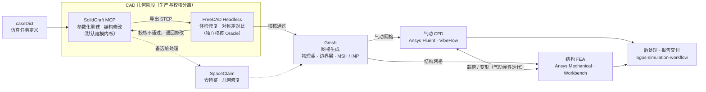
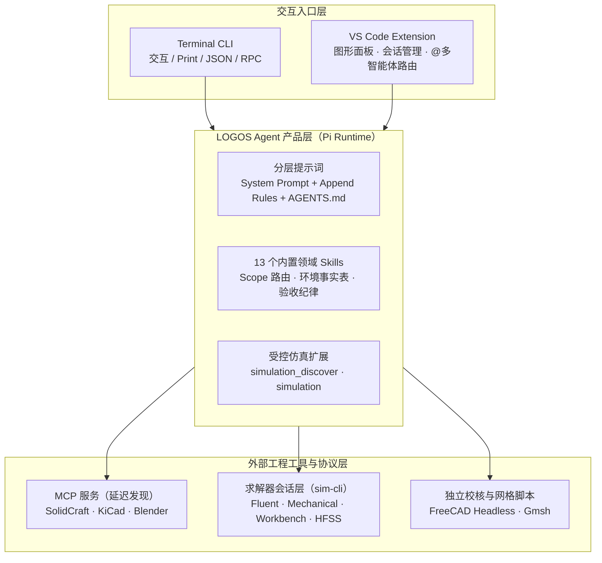

# LOGOS — 飞行器设计与多物理场仿真智能体

> 将大语言模型转化为**可动手、可验证、可追溯**的工程与仿真智能体平台。

> **仓库说明**：本仓库为 **LOGOS** 项目的公开架构与能力展示页（仅包含 README）。完整工程代码、内部求解器适配配置与部署脚本在私有仓库维护。

---

## 项目简介

**LOGOS** 是面向飞行器多学科设计与多物理场数值仿真的 AI Agent 平台。工程师可在项目工作区中通过自然语言下达任务，由智能体自主调度并串联 **CAD 参数化建模与独立校核、有限元网格划分、气动 CFD、结构 FEA、高频电磁仿真、电路板（ECAD）分析与 3D 可视化渲染**等全链路工程任务，并以测试结果、导出文件与渲染截图等可验证证据交付。

平台核心设计原则：

1. **Coding-Agent 内核 + 分层提示词与技能路由**：基于开源 Pi Runtime 构建产品层，将各领域工程软件操作规程、本机环境事实表与验收标准沉淀为热加载 Skills。
2. **MCP 协议统一集成 + 延迟按需发现**：外部工程软件通过 MCP 协议接入，采用 `exposure: deferred` 按需发现工具，避免工具面膨胀。
3. **CAD 生产与校核分离（Dual-Kernel Verification）**：建模与校核强制使用双内核解耦（SolidCraft 建模 → FreeCAD 独立复核），校核不通过自动退回修正，杜绝“生产工具给自己发合格证”。
4. **受控求解器执行与证据分层**：求解器调用遵循“探测安装 → 选型 → 会话执行”受控链路，按 UUID 留存执行审计目录，显式区分传输成功（`transport_ok`）、脚本成功（`script_ok`）与工程验收（`acceptance`）。
5. **CLI + VS Code 双形态交付**：同时支持终端 CLI（交互 / print / JSON / RPC 四种模式）与 VS Code 图形化扩展（会话管理、多智能体 `@` 路由与跨平台更新）。

---

## 核心工程管线

### 1. 几何 → 网格 → 气动 / 结构多物理场耦合管线

### 2. 智能体运行时分层架构

---

## 已接入工程软件与工具生态

| 领域 | 工程软件 | 接入方式与核心能力 |
|---|---|---|
| **CFD 气动仿真** | Ansys Fluent / VibeFlow | 受控 sim 会话 / PyFluent 脚本 / 批处理 journal、残差监控与断点续算 |
| **结构 FEA** | Ansys Mechanical | sim-cli + PyMechanical 实时会话、DPF 离线 `.rst` 结果提取 |
| **多物理场协同** | Ansys Workbench | sim-cli journal 驱动与持久会话交接 |
| **高频电磁** | Ansys HFSS | PyAEDT / AEDT 3D 电磁建模与求解工作流 |
| **几何前处理** | Ansys SpaceClaim / Discovery | 脚本化几何检查、修复与去特征 |
| **CAD 参数化建模** | SolidCraft | MCP 服务（9 工具）：参数化重建、装配、测量、截图与导出 |
| **CAD 独立校核** | FreeCAD 1.1.4 | 无头脚本技能（`inspect_cad` / `compare_step` / `heal_convert`）：几何体检、对称差复核与格式转换 |
| **网格划分** | Gmsh | CLI / Python API：STEP/BREP 导入、物理组、边界层、质量检查与 MSH/INP 导出 |
| **ECAD 电路板** | KiCad | 自维护 MCP Fork（47 工具）：原理图/PCB 读取编辑、网表连通性、ERC/DRC 校验、Gerber/SVG/STEP 导出、设备树与引脚分析 |
| **3D 可视化渲染** | Blender LTS | MCP 服务（9 工具，xvfb 常驻 GUI 实例）：3D 建模、材质渲染、PNG/MP4/GLB 导出 |

---

## 内置领域 Skills 体系

所有领域经验以模块化 `SKILL.md` + `references/` 形式沉淀，按需加载、热更新生效：

| 类别 | 内置 Skills | 覆盖职责 |
|---|---|---|
| **流程与求解纪律** | `logos-simulation-workflow`、`sim-cli` | 几何 → 网格 → 求解 → 后处理 → 报告阶段交接；安装探测、会话所有权、验收与失败处理 |
| **多物理场求解** | `fluent-sim`、`vibeflow-fluent`、`mechanical-sim`、`workbench-sim`、`hfss` | 气动 CFD、结构 FEA、多物理项目编排与高频电磁仿真 |
| **几何与网格** | `solidcraft`、`freecad`、`spaceclaim`、`gmsh` | 参数化建模、双内核几何交叉验证、前处理修复与有限元网格生成 |
| **硬件与可视化** | `kicad`、`blender` | ECAD 原理图/PCB 全流程分析校验与 3D 渲染交付 |

---

## 关键工程设计亮点

### 1. 受控求解器调用与防误判机制
- **无 Shell 拼接执行**：通过 `simulation_discover` 先探测本机/远端求解器安装并签发安装 ID，再由 `simulation` 工具直接启动受控子进程执行 `launch` / `probe` / `attach`，避免命令行注入与凭据落盘。
- **三层状态显式分离**：每次调用生成独立 `.logos/simulation/operations/<UUID>/` 审计记录，明确区分 `transport_ok`（通信/进程退出）、`script_ok`（脚本执行结果）与 `acceptance`（工程验收结论），不将进程返回 0 误判为仿真收敛或正确。
- **确定性失败语义**：超时或取消操作时立即终止客户端并将远端状态标记为 `unknown`，禁止盲目重试导致求解冲突或算力浪费。

### 2. 面向长程仿真任务的工作流重构与提效
- 围绕振型计算平台重构多步骤工作流与工具调用逻辑，沉淀面向多物理场任务的可复用仿真算子。
- 在某飞行器仿真任务中，单次任务执行耗时由 **46 min 缩短至 20 min**，以 AI 仿真流程替代约 **60%** 的原有仿真工作。

### 3. 跨平台双形态交付
- **Terminal CLI**：保留调用者工作目录并自动发现项目 `AGENTS.md`，支持一键项目级会话管理及 `interactive / print / JSON / RPC` 四种运行模式。
- **VS Code 扩展**：提供侧边栏图形交互面板、服务器连接监控、历史会话管理、多智能体 `@` 路由（`@logos`、`@kicad`、`@freecad`、`@ansys`），并在 Windows/Linux 发行包中内置独立可迁移 Python 后端与自检更新能力。

---

## 验证与测试概览

| 模块 | 验证内容 | 状态 |
|---|---|---|
| **运行时与部署** | Linux 服务端源码部署、Pi Runtime 启动、CLI/RPC 模式 | 已验证 |
| **仿真集成（sim-cli）** | 57 项 Python 单元测试 + 8 项 Node 集成测试 + 双插件健康检查 | 已通过 |
| **KiCad MCP Fork** | 47 项工具接口、29 项离线回归测试 + 14 项 stdio 冒烟测试 | 已通过 |
| **FreeCAD 校核技能** | 几何体检 / 对称差对比 / 修复转换三脚本，10 项回归测试 | 已通过 |
| **Blender MCP** | 常驻 xvfb GUI 实例 + 3D 材质渲染与多格式导出链路 | 已验证 |
| **飞行器仿真场景** | 气动/结构/电磁多物理场耦合 Agent 及振型计算平台重构（46 min → 20 min） | 实测落地 |
